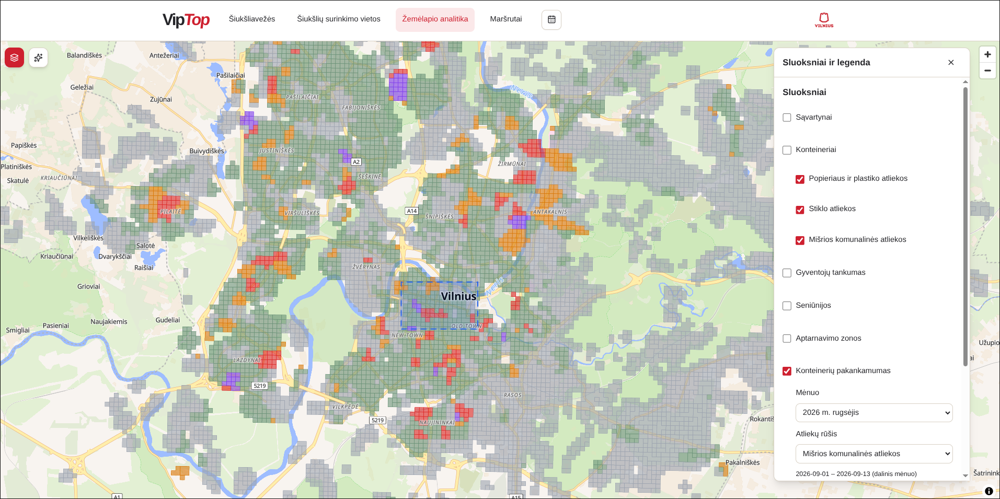
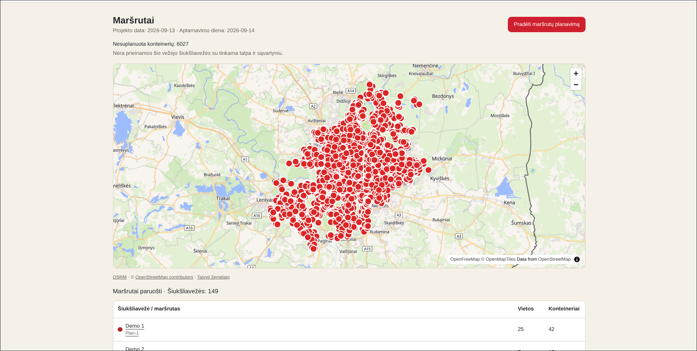
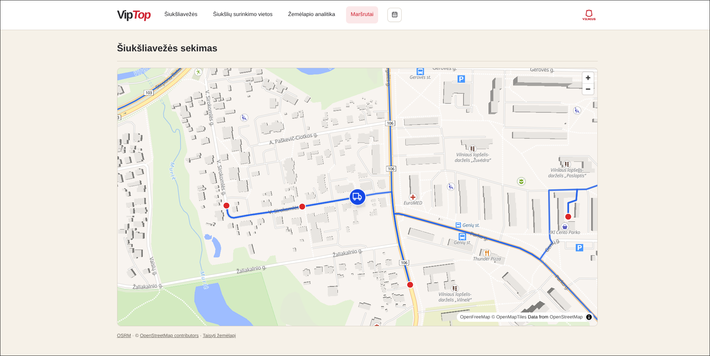
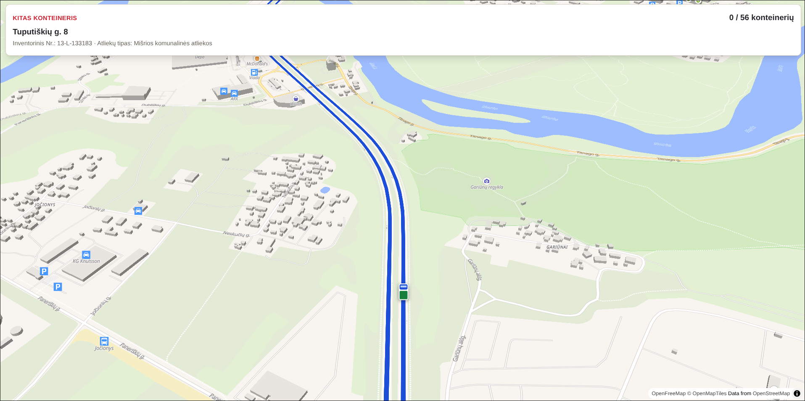

# VipTop — Waste Collection Optimisation for Vilnius

Project made in 2 days during Hack4Vilnius 2026 hackathon using spec driven development (SDD) with OpenSpec framework

**From bin data to a collection plan, optimised truck routes and driver guidance.**

Waste collection involves two connected decisions: which containers need service, and how to collect them with the available fleet. VipTop brings fill prediction, route optimisation and geographic analysis into one application so dispatchers can plan collections around predicted demand and drivers can record what they find on site.

Built by **two software developers and one data analyst during a one-week hackathon**, this MVP connects data engineering, machine learning, constrained optimisation and a Lithuanian-language web interface for administrators, drivers and residents.

**Workflow:** Import collection data → predict next-day fill → prioritise stops → optimise truck trips → follow road routes → record bin observations.






## Features

| Capability | Value | Implementation / reference |
|---|---|---|
| Next-day fill prediction | Identifies bins likely to need collection | CatBoost / Random Forest comparison, one exported model and shared CPU inference; [ML workflow](docs/data/fill-prediction.md) |
| Capacity-constrained route optimisation | Assigns stops to trucks, including landfill reloads, and compares stored plans with a nearest-neighbour baseline | PyVRP, carrier-specific fleets and explicit unserved stops; [route planning](docs/data/route-plan.md) |
| Road routes and driver workflow | Connects dispatch planning to stop-by-stop guidance and recorded bin fill observations | OSRM road geometry, mobile driver screens and simulated truck movement; [driver guide](docs/driver.md) |
| Geographic analytics | Helps assess container coverage against population and service areas | MapLibre maps, population estimates and monthly container adequacy; [map specification](openspec/specs/map-analytics/spec.md) |
| AI area analysis | Turns a selected map area into an explanation backed by database queries | Bounded, read-only tool calling; [area analyst specification](openspec/specs/area-analytics-agent/spec.md) |
| Site and fleet management | Keeps collection sites, containers and truck capacity in one operational view | [Sites](openspec/specs/collection-site-management/spec.md), [trucks](openspec/specs/truck-management/spec.md) |
| Resident requests | Gives residents a direct way to request a bin emptying | Bin-specific public page; [resident requests](openspec/specs/resident-requests/spec.md) |

**MVP scope:** Registry and collection records come from VASA exports; fill labels are synthetic, so predictions demonstrate the workflow rather than validated field accuracy. Planning uses a September 2026 simulation window. Optimiser distances are estimates; displayed road paths come from OSRM. The UI has no authentication. See [prediction assumptions](docs/data/fill-prediction.md#assumptions) and [routing assumptions](docs/data/route-plan.md#assumptions).

**Stack:** React · TypeScript · Vite · Tailwind CSS · shadcn/ui · MapLibre GL · Python 3.12 · FastAPI · Pydantic · SQLAlchemy · Alembic · PostgreSQL · PyVRP · Docker Compose · GitHub Actions

The backend keeps data processing, prediction and optimisation behind separate Python modules in one application. A portable inference package shares feature construction between research and application use. [OpenSpec](openspec/specs/) captures product behaviour and implementation changes.

## Quick Start

You need **Docker with Docker Compose** and **data exports supplied separately by the team**. CSVs, GeoJSON sources and trained model artifacts are not bundled with the repository.

1. Put `sites_<digits>.csv`, `bins_<digits>.csv` and `bin_hist_<digits>.csv` in `backend/data/` (or set `VIPTOP_DATA_DIR` in `.env`).
2. Create the configuration and start the stack; database migrations run automatically:

   ```bash
   test -f .env || cp .env.example .env
   docker compose up --build -d
   ```

3. Import the exports:

   ```bash
   docker compose exec backend uv run python -m app.interfaces.table_import
   ```

4. Open **[the application](http://localhost:5173)** or **[the API reference](http://localhost:8000/docs)**. The backend runs at <http://localhost:8000>.

This starts the application and loads collection records. For the full planning demo, supply the [trained model and input CSVs](docs/data/fill-prediction.md#application-demo-runtime), prepare the fleet using [route planning setup](docs/development.md#route-planning), then open `/admin/routes`. The map analyst also needs backend-only `OPENAI_API_KEY` and `OPENAI_MODEL` settings; see [AI configuration](docs/development.md#area-analyst-configuration-and-diagnostics).

Do not use `bin_sync` for development data: it takes hours. For native development, configuration and parallel checkouts, see [Development](docs/development.md).

## Data pipeline

The database workflow runs in the order below. Each module runs with `docker compose exec backend uv run python -m app.interfaces.<module>`. Importing bins clears derived tables; see [import side effects](docs/data/import.md#what-an-import-replaces).

| Step | Module | Output / prerequisites | Docs |
|---|---|---|---|
| 1 | `table_import` | Sites, bins and collection records; optional schedules, resident requests, district and service-zone GeoJSON | [Import](docs/data/import.md) |
| 2 | `bin_population` | Residents estimated per bin; requires `population_density_1ha.geojson` | [Population](docs/data/bin-population.md) |
| 3 | `bin_days --start ... --end ...` | Bin-day calendar with simulated collections; supply schedule exports for planned dates | [Bin days](docs/data/bin-days.md) |
| 4 | `collection_plan --date ...` | Sites due per carrier, using the supplied prediction model and enriched CSV inputs | [Collection plan](docs/data/collection-plan.md) |
| 5 | `demo_fleet --date ...` | Invented fleet sized from the stored collection plan | [Demo fleet](docs/data/route-plan.md#demo-fleet) |
| 6 | `route_plan --carrier ... --date ...` | Stored truck trips and baseline comparison | [Route plan](docs/data/route-plan.md) |

Offline preparation and analysis use separate inputs and optional dependencies:

| Stage | Command | Docs |
|---|---|---|
| Prepare synthetic fill labels | From root: `python scripts/prepare_training_data.py`, then `python scripts/fill_qr.py` | [Fill/QR generation](docs/data/fill-qr.md) |
| Compare models and export inference product | From `backend/`: `python -m app.ml.run --config configs/ml.yaml` | [Fill prediction](docs/data/fill-prediction.md) |
| Build monthly container adequacy layers | From `backend/`: `uv run --extra analytics python -m app.interfaces.container_adequacy --all-complete --daily data/bin_days_20231010_20261009_enriched.csv` | [Container adequacy](docs/data/container-adequacy.md) |

The interactive planning demo uses the current fleet and calculates transient road routes; it is separate from the stored-plan commands above. Run `docker compose exec backend uv run python -m app.interfaces.demo --date 2026-09-14 --navigation` for a repeatable prediction-and-routing check; see [demo setup](docs/development.md#route-planning).

## Project structure

```text
.
├── frontend/src/
│   ├── pages/              # Admin, driver and resident workflows
│   ├── components/         # Maps, layout and shared UI
│   └── brand/              # Application theme and presentation
├── backend/
│   ├── app/
│   │   ├── interfaces/     # HTTP routers and data CLIs
│   │   ├── services/       # Planning, analytics and application logic
│   │   ├── optimization/   # Shared PyVRP route solver
│   │   ├── ml/             # Training orchestration and prediction adapter
│   │   ├── infrastructure/ # Database engine and ORM models
│   │   ├── integrations/   # VASA client
│   │   └── core/           # Settings
│   ├── viptop_fill/        # Portable features and CPU inference
│   ├── configs/ml.yaml     # Reproducible ML inputs and resource limits
│   ├── alembic/            # Database migrations
│   └── data/               # Ignored data exports and model artifacts
├── scripts/                # Data preparation and development utilities
├── docs/                   # Setup, data and operational documentation
└── openspec/               # Product specifications and scoped changes
```

## Documentation

- [Development](docs/development.md): configuration, native setup, migrations, parallel worktrees and planning/AI setup
- [Data model](docs/data-model.md): database tables and data meaning
- [Driver guide](docs/driver.md): preparing and running the driver demo
- [Analytics agent guidance](docs/agent-skills.md): analytical procedure and runtime domain references
- Data preparation: [CSV import](docs/data/import.md), [resident allocation](docs/data/bin-population.md), [bin-day calendar](docs/data/bin-days.md), [column dictionary](docs/data/bin-days-columns.md)
- Planning: [collection plan](docs/data/collection-plan.md), [route plan and verification](docs/data/route-plan.md)
- Geographic layers: [district boundaries](docs/data/district-boundaries.md), [service zones](docs/data/service-zones.md), [container adequacy](docs/data/container-adequacy.md)
- Source refresh commands: [VASA bin sync](docs/data/bin-sync.md), [schedule sync](docs/data/bin-schedule-sync.md)
- Machine learning: [synthetic fill/QR generation](docs/data/fill-qr.md), [training, evaluation and inference](docs/data/fill-prediction.md)
- [Product specifications](openspec/specs/) · [AI contributor instructions](AGENTS.md) · [Interactive API reference](http://localhost:8000/docs) (running backend)
